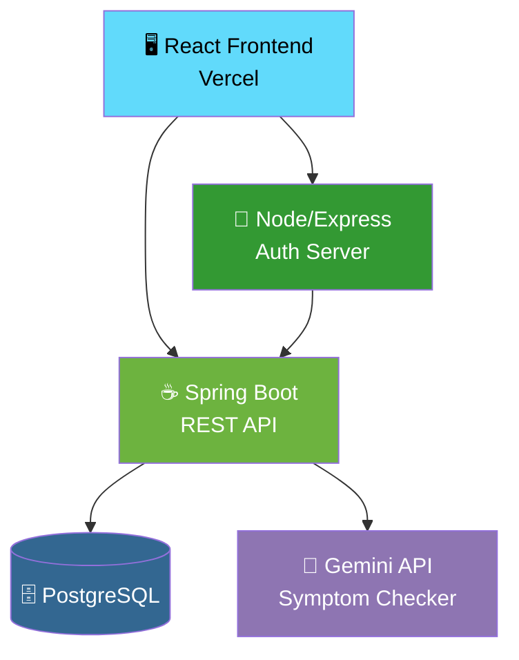
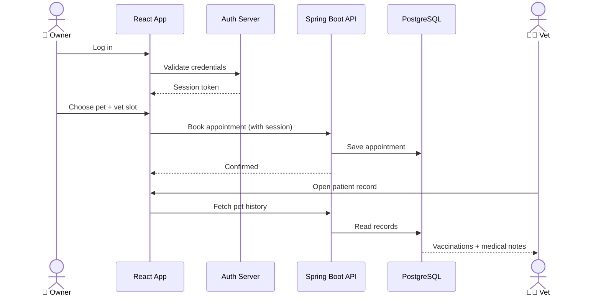
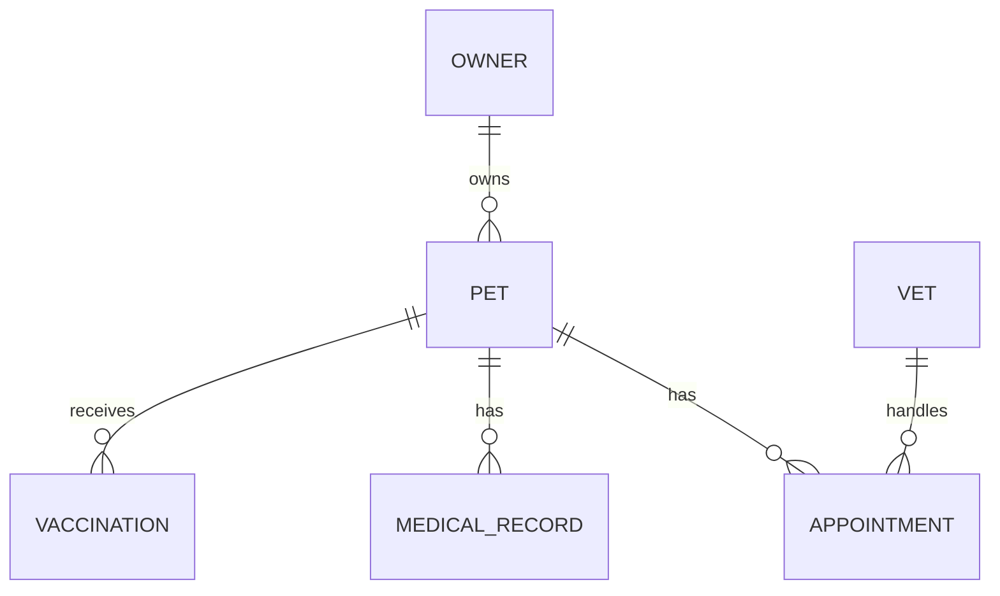

<div align="center">


### 🐾 One platform where pet owners, vets and AI work together

<a href="https://smart-petcare-web.vercel.app">
  
</a>

<br/>

[](https://react.dev)
[](https://spring.io/projects/spring-boot)
[](https://nodejs.org)
[](https://www.postgresql.org)
[](https://ai.google.dev)
[](https://smart-petcare-web.vercel.app)
[](#-license)

<br/>

### 🚀 [**Try the Live Demo**](https://smart-petcare-web.vercel.app)

[Problem](#-the-problem) · [Solution](#-the-solution) · [Features](#-features--status) · [Screenshots](#-screenshots) · [Architecture](#%EF%B8%8F-system-architecture) · [AI Triage](#-ai-symptom-triage) · [Quick Start](#-quick-start) · [Roadmap](#%EF%B8%8F-roadmap)

</div>

---

## 😟 The Problem

> *"My dog has been limping since yesterday... is this serious? Should I go now or wait?"*

Every pet owner has asked this. And the system around it is broken:

| 😕 Owner's side | 🩺 Vet's side |
|---|---|
| Records scattered across paper files and chats | Visits start with little or no history |
| No idea whether a symptom is urgent | Walk-ins and phone calls disrupt the schedule |
| Vaccination dates forgotten | No shared view of a pet's medical timeline |

## 💡 The Solution

**Smart Pet Care** gives both sides one shared space.

```
   🐶 OWNER                                      👩‍⚕️ VET
 ┌────────────────────┐                   ┌─────────────────────┐
 │ Pet profiles       │                   │ Patient list        │
 │ Symptom chat (AI)  │ ───── shared ───► │ Full medical record │
 │ Book appointments  │      records      │ Vaccination history │
 │ Vaccination log    │ ◄──────────────── │ Appointment view    │
 └────────────────────┘                   └─────────────────────┘
```

---

## ✨ Why It Stands Out

| 🧠 Understands free text | 🤝 Owner ↔ Vet bridge | 🔐 Role-based access | 🌐 Actually deployed |
|---|---|---|---|
| Owners describe symptoms in their own words, not dropdowns | One shared record trail instead of scattered notes | Owners and vets each see only what belongs to them | Live on Vercel, not just localhost |

---

## 🎯 Features & Status

| Feature | What it does | Status |
|---|---|---|
| 🐾 **Pet Profiles** | Breed, age and medical notes for every pet | ✅ Done |
| 👩‍⚕️ **Owner & Vet Portals** | Separate role-based dashboards | ✅ Done |
| 🔐 **Authentication** | Dedicated auth server for login and sessions | ✅ Done |
| 📅 **Appointment Booking** | Owners book vet slots | ✅ Done |
| 💉 **Vaccination & Medical Records** | History shared between owner and vet | ✅ Done |
| 🌐 **Live Deployment** | Frontend hosted on Vercel | ✅ Done |
| 💬 **AI Symptom Checker** | Gemini-based triage from free-text symptoms | 🚧 In progress |
| 🔔 **Email/SMS Reminders** | Automated appointment reminders | 🔲 Planned |
| 📊 **Vitals & Wellness Logs** | Weight, activity and feeding trends | 🔲 Planned |

> ✅ Done · 🚧 In progress · 🔲 Planned

---

## 📸 Screenshots

> 👉 Add real images in `docs/screenshots/` and keep these file names.

<div align="center">

| 🏠 Owner Dashboard | 🩺 Vet Dashboard |
|:---:|:---:|
|  |  |

| 📅 Appointment Booking | 💉 Medical Records |
|:---:|:---:|
|  |  |

### 🎬 Demo


</div>

---

## 🏗️ System Architecture



### 🔄 Booking Flow



### 🧩 Entity Relationships (simplified)



> Full schema and seed data: [`database/schema.sql`](database/schema.sql)

---

## 🧠 Tech Decisions

| Layer | Tech | Why I chose it |
|---|---|---|
| 🖥️ Frontend | **React** | Component-based UI makes separate owner and vet views easy; free, fast deploys on Vercel |
| ☕ API | **Spring Boot** | Clear controller → service → repository layering for business rules like appointments and records |
| 🔐 Auth | **Node/Express** | Small, independent session service so login logic stays separate from the main API |
| 🗄️ Database | **PostgreSQL** | Data is relational (owners → pets → appointments → records) |
| 💬 AI | **Gemini API** | Understands free-text symptoms instead of forcing fixed options |

---

## 💬 AI Symptom Triage

> 🚧 **In progress.** Designed so the AI only *advises*. A human vet always makes the call.

```
 🐶 "My dog has been limping since yesterday"
        │
        ▼
 🔐 Auth check ......... valid session + owner owns this pet
        │
        ▼
 💬 Gemini triage ...... symptom + duration + pet profile
        │
        ▼
 📊 Urgency estimate ... MODERATE
        │
        ▼
 📅 Next step .......... suggest earliest vet slot
 📖 Record ............. summary saved for the vet to review
```

### 🚦 Urgency Levels

| Level | Meaning | Suggested action |
|---|---|---|
| 🟢 **Low** | Mild, no red flags | Monitor at home, book a routine visit if it continues |
| 🟡 **Moderate** | Should be checked soon | Book the earliest available slot |
| 🟠 **High** | Concerning symptoms | Same-day vet visit |
| 🔴 **Emergency** | Possible life-threatening signs | Go to a vet or emergency clinic immediately |

> ⚠️ **Disclaimer:** The symptom checker gives guidance only. It is not a diagnosis and does not replace a veterinarian.

---

## 🧗 Challenges & What I Learned

| Challenge | How I handled it |
|---|---|
| Frontend on Vercel needs to reach a backend running locally | Used a Cloudflare Tunnel during development |
| Owners and vets need different views of the same data | Role-based auth with a dedicated session server |
| Several services (React, Spring Boot, Node, PostgreSQL) must work together | Defined clear responsibilities per service and a single data store |
| AI answers must not be mistaken for medical advice | Urgency estimates with a clear disclaimer; the vet stays the decision maker |

**Skills practiced:** REST API design · relational schema design · role-based access · multi-service architecture · cloud deployment · LLM integration

---

## 📁 Project Structure

```
SMART-PETCARE-WEB/
├── 🗄️ database/
│   └── schema.sql            Owners · pets · vets · appointments · records
├── ☕ backend/                Spring Boot REST API
│   └── src/main/java/...     Controllers · Services · Repositories · Entities
├── 🖥️ frontend/               React web app
│   └── src/                  Components · Pages · Services · Hooks
├── 📚 docs/                   Documentation and screenshots
├── 🔐 auth-server.js          Node/Express auth server
└── package.json
```

---

## 🚀 Quick Start

**Prerequisites:** Java 17+, Node.js 18+, PostgreSQL, Git

<details>
<summary><b>👉 Click to expand setup steps</b></summary>

<br/>

**1 · Clone**
```bash
git clone https://github.com/HareshK-14/SMART-PETCARE-WEB.git
cd SMART-PETCARE-WEB
```

**2 · Set up the database**
```sql
-- inside psql or pgAdmin
\i database/schema.sql
```

**3 · Run the Spring Boot backend**
```bash
cd backend
./mvnw spring-boot:run
```

**4 · Run the auth server**
```bash
node auth-server.js
```

**5 · Run the frontend**
```bash
cd frontend
npm install
npm run dev
```

**6 · (Optional) Expose your local backend to the deployed frontend**
```bash
cloudflared tunnel --url http://localhost:8080
```

**🔑 Configuration:** keep secrets (database password, Gemini API key) in environment variables or a git-ignored local file. Never commit them.

</details>

---

## 🔐 Security Notes

- Owners and vets only access the data their role allows.
- The development auth store is **for local use only**. For production, use a database-backed user table with hashed passwords.
- Add these to `.gitignore`:

```
auth-users.json
cloudflared.exe
.env
```

---

## 🗺️ Roadmap

```
✅ Stage 1  ━━  PostgreSQL schema + seed data
✅ Stage 2  ━━  Spring Boot REST API + Node/Express auth server
✅ Stage 3  ━━  React frontend deployed on Vercel
🚧 Stage 4  ━━  AI symptom checker (Gemini)           ◄── you are here
🔲 Stage 5  ━━  Email/SMS appointment reminders
🔲 Stage 6  ━━  Vaccination/medical record dashboard polish
🔲 Stage 7  ━━  Docker Compose for one-command setup
```

---

## ❓ FAQ

<details>
<summary><b>Why a separate Node auth server alongside Spring Boot?</b></summary>
<br/>
It keeps login and session handling independent from the business API, so each service has one clear job and can be changed without touching the other.
</details>

<details>
<summary><b>Does the AI diagnose my pet?</b></summary>
<br/>
No. It estimates urgency from the symptoms you describe and suggests a next step. A veterinarian always makes the diagnosis.
</details>

<details>
<summary><b>Is it production-ready?</b></summary>
<br/>
It is a working full-stack project with a live frontend. Production hardening (database-backed auth, reminders, containerization) is on the roadmap.
</details>

---

## 👤 Developer

<div align="center">

**Haresh K** · Full-Stack Developer (solo project)
B.Tech Information Technology, V.S.B Engineering College, Karur

[](https://github.com/HareshK-14)
[](https://smart-petcare-web.vercel.app)

</div>

---

## 📄 License

Released under the [MIT License](LICENSE).

<div align="center">

### ⭐ If this project helped or inspired you, give it a star!

Made with 🐾 for pet owners and their vets.


</div>
